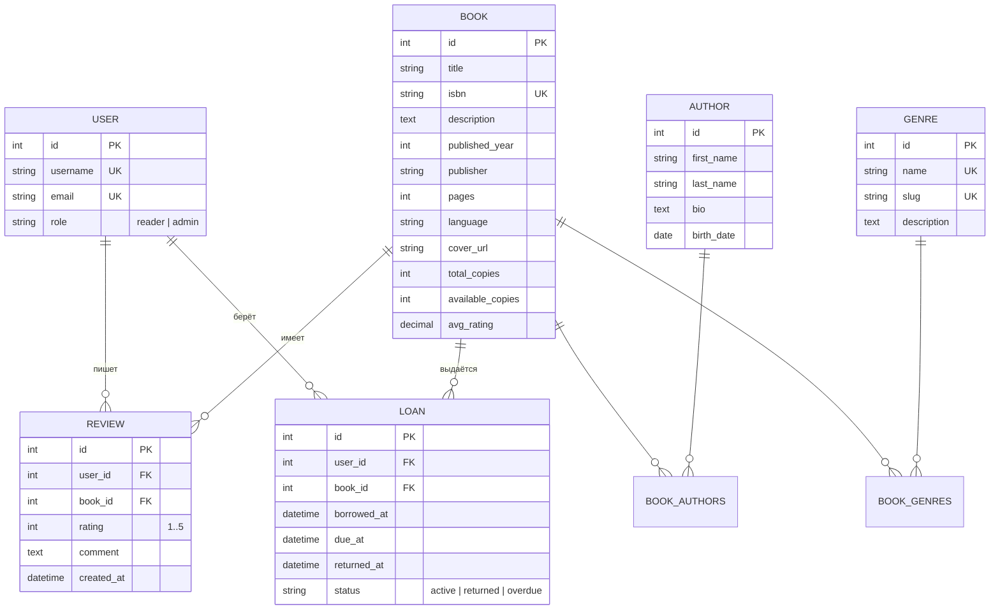

# Архитектурный документ: «Онлайн-библиотека книг»
Версия: 2.0 (Учебная архитектура: Django REST Framework + Базовый React JS)
Назначение: единый контракт для разработки проекта.

## 1. Схема базы данных (ER-диаграмма)

### 1.1. Таблицы БД (6 основных + 2 связующие M2M)
| Таблица | Назначение |
| :--- | :--- |
| `users_user` | Пользователи (`reader`, `admin`). Наследуется от `AbstractUser`. |
| `catalog_author` | Авторы книг. |
| `catalog_genre` | Жанры книг. |
| `catalog_book` | Книги (основная таблица каталога). |
| `catalog_book_authors` | Связь M2M: книга ↔ автор. |
| `catalog_book_genres` | Связь M2M: книга ↔ жанр. |
| `reviews_review` | Отзывы и оценки (1..5) пользователей на книги. |
| `loans_loan` | Выдачи книг читателям (история «взял / вернул»). |

### 1.2. Диаграмма связей (Mermaid)


### 1.3. Основные правила бизнес-логики
1. Один пользователь может оставить только один отзыв на конкретную книгу (`UniqueConstraint(user, book)`). Оценка `rating` от 1 до 5.
2. При добавлении или удалении отзыва поле `avg_rating` у книги автоматически пересчитывается через стандартный `Avg('reviews__rating')`.
3. При взятии книги (`POST /api/v1/loans/`) проверяется `book.available_copies > 0`. Если свободных копий нет — возвращается код `409 Conflict`. При успешной выдаче `available_copies` уменьшается на 1, при возврате — увеличивается на 1.

---

## 2. REST API Эндпоинты
Базовый префикс: `/api/v1/`. Формат данных — JSON.
Авторизация — токен в заголовке `Authorization: Token <token>` (или `Bearer <token>`), хранится в `localStorage`.

* **Аутентификация (`/api/v1/auth/`):**
  * `POST /auth/register/` — регистрация нового читателя (`username`, `email`, `password`, `password_confirm`).
  * `POST /auth/login/` — вход по логину и паролю, возвращает `{ token, user }`.
  * `POST /auth/logout/` — выход из системы.
  * `GET /auth/me/` — получение данных текущего пользователя (`id`, `username`, `email`, `role`).
* **Авторы и Жанры (`/api/v1/authors/`, `/api/v1/genres/`):**
  * `GET` — список всех авторов / жанров (доступно всем).
  * `POST, PATCH, DELETE` — создание, изменение, удаление (только `admin`).
* **Книги (`/api/v1/books/`):**
  * `GET /books/` — список книг с поиском (`?search=`), фильтрацией (`?genre=`, `?author=`), сортировкой (`?ordering=`) и пагинацией (`?page=`).
  * `GET /books/{id}/` — детальная карточка книги.
  * `POST, PATCH, DELETE /books/{id}/` — управление книгами (только `admin`).
  * `POST /books/import-csv/` — массовая загрузка книг из CSV-файла (только `admin`).
* **Отзывы (`/api/v1/reviews/` и `/api/v1/books/{id}/reviews/`):**
  * `GET` — список отзывов по книге или пользователю.
  * `POST` — добавить отзыв (`rating`, `comment`). При дубле возвращает `409`.
  * `DELETE /reviews/{id}/` — удалить свой отзыв (или любой для `admin`).
* **Выдачи (`/api/v1/loans/`):**
  * `GET /loans/` — список выдач текущего читателя.
  * `POST /loans/` — взять книгу (`book_id`, `due_at`).
  * `POST /loans/{id}/return/` — вернуть книгу в библиотеку.
* **Документация OpenAPI:**
  * `GET /api/v1/schema/` — YAML-схема (`drf-spectacular`).
  * `GET /api/v1/docs/` — интерактивный Swagger UI.

---

## 3. Упрощенная структура репозитория

```text
online_library/
├── README.md
├── docker-compose.yml
├── .env.example
├── .gitignore
├── docs/
│   ├── ARCHITECTURE.md
│   ├── openapi.yaml
│   ├── er-diagram.md
│   └── adr/
│       ├── 0001-stack.md
│       └── 0002-auth-token.md
│
├── backend/
│   ├── requirements.txt         # Простой список пакетов (Django, DRF, drf-spectacular, pytest)
│   ├── manage.py
│   ├── pytest.ini
│   ├── library_project/         # Стандартная папка настроек Django
│   │   ├── __init__.py
│   │   ├── settings.py          # Единый и понятный файл настроек
│   │   ├── urls.py
│   │   └── wsgi.py
│   └── apps/
│       ├── users/               # Модель User, логин, регистрация
│       ├── catalog/             # Модели Author, Genre, Book + импорт CSV
│       ├── reviews/             # Модель Review + пересчет рейтинга
│       └── loans/               # Модель Loan (взять / вернуть книгу)
│
└── frontend/
    ├── package.json             # Только react, react-dom, react-router-dom и vite
    ├── vite.config.js
    ├── index.html
    └── src/
        ├── main.jsx             # Точка входа React
        ├── App.jsx              # Роутер (Routes / Route) и шапка сайта (Navbar)
        ├── api.js               # Простые функции fetch() с токеном из localStorage
        ├── styles.css           # Единые стили, светлая/темная тема и мобильная верстка
        ├── components/
        │   └── BookCard.jsx     # Компонент карточки книги для каталога
        └── pages/
            ├── CatalogPage.jsx  # 1. Каталог книг (плитка/список, поиск, фильтры)
            ├── BookPage.jsx     # 2. Страница книги + Форма отзыва + Форма выдачи
            ├── LoginPage.jsx    # 3. Вход (Форма логина)
            ├── RegisterPage.jsx # 4. Регистрация (Форма регистрации)
            ├── ProfilePage.jsx  # 5. Личный кабинет (мои книги и отзывы)
            └── AdminPage.jsx    # 6. Админ-панель (Форма добавления книги + CSV импорт)
```

---

## 4. Страницы (6) и Формы (5) фронтенда на базовом React (.jsx)

Все компоненты написаны как обычные функции JavaScript с использованием только базовых хуков `useState` и `useEffect`:
1. **`CatalogPage.jsx` (`/`)**: загружает книги через `useEffect` + `fetch`, хранит список в `useState`, позволяет переключать вид «Плитка / Список», искать и фильтровать книги.
2. **`BookPage.jsx` (`/books/:id`)**: показывает описание книги, список отзывов, **Форму 3 (Оставить отзыв)** и **Форму 4 (Взять книгу до выбранной даты)**.
3. **`LoginPage.jsx` (`/login`)**: **Форма 1 (Вход)** — отправляет логин/пароль, сохраняет `token` и `user` в `localStorage`.
4. **`RegisterPage.jsx` (`/register`)**: **Форма 2 (Регистрация)** — проверяет совпадение паролей и регистрирует читателя.
5. **`ProfilePage.jsx` (`/profile`)**: отображает взятые книги с кнопкой «Вернуть книгу» и отзывы пользователя.
6. **`AdminPage.jsx` (`/admin`)**: доступна роли `admin`, содержит таблицу книг, **Форму 5 (Добавление книги с выбором авторов и жанров)** и кнопку загрузки CSV-файла.
