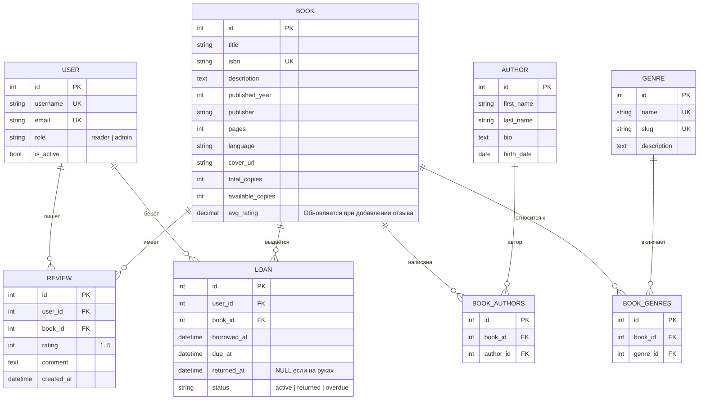

# ER-диаграмма и схема базы данных «Онлайн-библиотека книг»

Документ фиксирует структуру реляционной базы данных (8 таблиц: 6 основных сущностей и 2 связующие таблицы M2M).

## 1. Диаграмма сущностей (Mermaid)

## 2. Ограничения целостности
* **Уникальные поля (UNIQUE):**
  * `users_user`: `username`, `email`
  * `catalog_genre`: `name`, `slug`
  * `catalog_book`: `isbn`
  * `reviews_review`: пара `(user_id, book_id)` (один пользователь — один отзыв на книгу).
* **Проверки значений:**
  * `reviews_review.rating`: от `1` до `5`.
  * `catalog_book.available_copies`: от `0` до `total_copies`.
